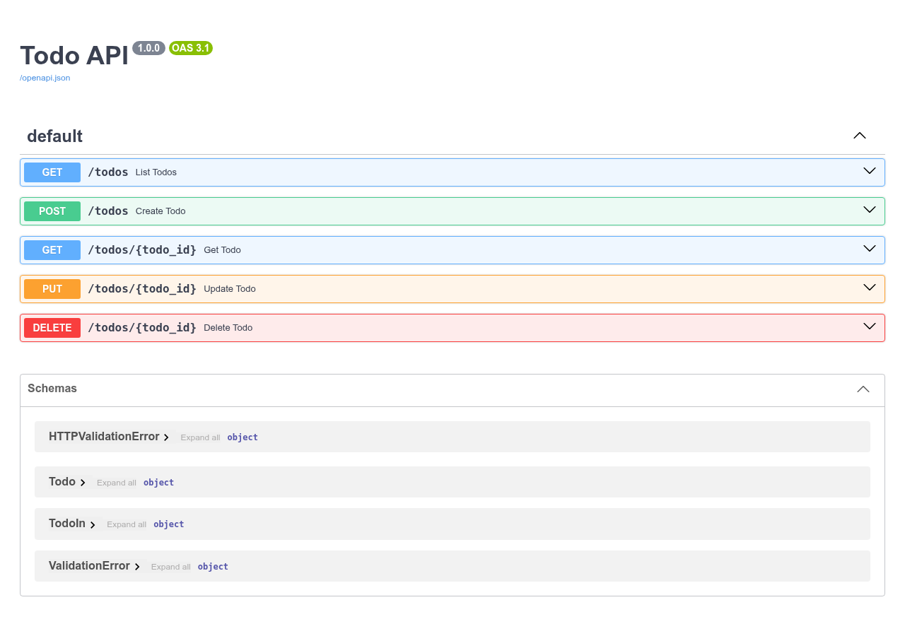

# Todo API

A small FastAPI service providing CRUD endpoints for todos. Data is kept in memory (swap in a real database for production).



## Features
- `GET /todos` – list todos, optional `?done=true|false` filter
- `POST /todos` – create a todo
- `GET /todos/{id}`, `PUT /todos/{id}`, `DELETE /todos/{id}`
- Interactive docs at `/docs`

## Website hooks
Browser-side hooks live in `.claude/hooks/` and are injected into the Swagger UI page at `/docs`.
- `meeting-reminder.js` – after a visitor has been on the page for 10 seconds, pops up a dialog
  reminding them of the IT Project Management meeting (next Wednesday, 10:00 AM, Room 888).
  Edit the `DELAY_MS` and `MESSAGE` constants at the top of the file to change it.

## Run
```bash
pip install -r requirements.txt
uvicorn main:app --reload
```

## Test
```bash
pytest
```

## Screenshot and assessment
```bash
pip install -r requirements-dev.txt && playwright install chromium
python scripts/screenshot.py        # writes docs/screenshot.png
python scripts/make_assessment.py   # writes assessment.docx
```
